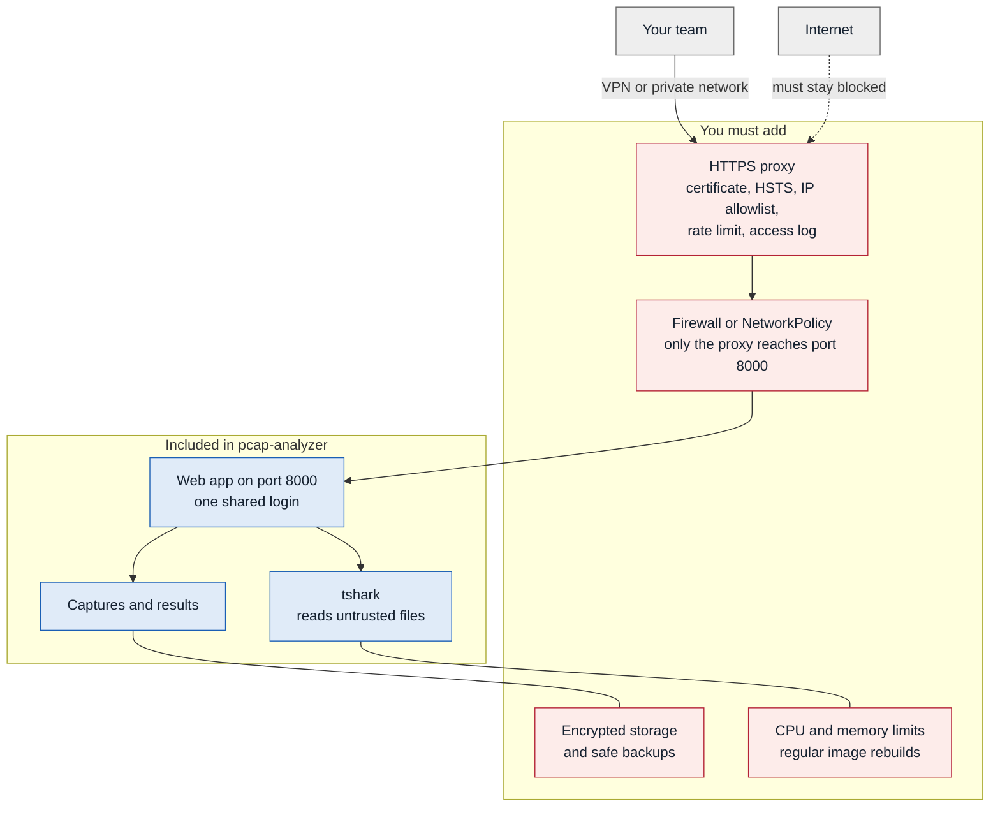

# pcap-analyzer

Find out why HTTP requests are slow, from a packet capture.

Upload a PCAP and see where the time went: connection setup, network delay, service time, data transfer, or packet loss. It runs on your own server, needs no internet access, and is designed for captures taken on either side of a load balancer such as NetScaler.

> [!WARNING]
> Do not expose this application to the internet. It is built for private networks, has had no independent security review, and leaves several protections to you. Read [Security](#security) before you deploy it.

## Features

- HTTP/1.1 and HTTP/2 timing per request, grouped by URL shape such as `/users/{id}`
- TCP connection list with the slowest requests of each connection
- Inspection of one traffic pair by source, destination, port, type, URL and size
- Root cause of slow requests in plain language
- Comparison of two captures, and matching the same requests seen at two points
- HTTPS decryption with a TLS key log file or RSA key
- Export to CSV, Excel, JSON, PNG, SVG, HTML and PCAP

> **Status: early release.** Tested with synthetic captures on tshark 4.4 and 4.6, and in a Kubernetes pod behind an NGINX Ingress. It has not yet been tested with real NetScaler `nstrace` files.

## Quick start

Requires Python 3.11+ and tshark 4.0+.

```bash
pip install .
pcap-analyzer hash-password
export PCAP_ANALYZER_ADMIN_PASSWORD_HASH='PASTE_HASH_HERE'
pcap-analyzer serve
```

Open <http://127.0.0.1:8000> and sign in as `admin`. The same engine works from the command line:

```bash
pcap-analyzer analyze capture.pcap --keylog keys.log --host 10.0.0.5 --port 8080
pcap-analyzer inspect ANALYSIS_ID --src 10.0.0.5 --dst 10.0.0.9 --port 8080
```

See [docs/install.md](docs/install.md) for Docker, Kubernetes, offline installs and settings. To run without Docker or sudo, see [legacy-linux-server](legacy-linux-server/README.md).

## Development

```bash
pip install -e ".[dev]"
pytest
```

Tests use synthetic captures from `tools/gen_samples.py`. Their timings are known in advance, and they contain only private IP addresses and fake data.

## Security

Packet captures and TLS keys can contain passwords, session cookies and personal data, so anyone who reaches this application may reach that data. The red boxes below are not part of this project. You must add them yourself.



### What is not included

| Missing | Why it matters | What you must do |
|---|---|---|
| HTTPS by default | The container serves plain HTTP on port 8000, so the password, captures and TLS keys can be read on the network. The app sends no HSTS header. | Put an HTTPS proxy in front with HSTS, or start with `--cert` and `--key`. |
| Protection of port 8000 | Whoever reaches the port directly skips your proxy's HTTPS, IP allowlist and logs. | Let only the proxy reach the port, with a firewall or a Kubernetes `NetworkPolicy`. The manifests here include none. |
| Lockout that cannot be misused | Sign-in stops for 5 minutes after 5 failed logins from one address, or 30 from all addresses. Someone can use this to block logins for a while. Open sessions keep working. Behind a proxy, all users count as one address until you set `PCAP_ANALYZER_TRUSTED_PROXIES`. | Set that variable to your proxy's addresses, add a rate limit at the proxy, and limit who can reach the app. |
| Separate users and an audit log | Everyone shares one login that can read, download and delete every analysis. Nothing records who did it. | Limit who gets the password, change it when someone leaves, and keep access logs at the proxy. |
| Multi-factor login and SSO | One password protects all the data. | Use a long random password, and require a VPN or an authenticating proxy. |
| CSRF tokens | Cross-site requests are refused, but a sibling subdomain counts as the same site. | Serve the app from a domain that has no untrusted subdomains. |
| Encryption at rest | Captures, results and exports are plain files. Kubernetes Secrets are plain in etcd unless you turn on encryption. | Use encrypted disks and encrypted backups, and turn on etcd encryption. |
| Complete masking | Only known header and field names are masked. Raw captures and PCAP exports are never masked. | Treat every result, report and export as sensitive. Set `PCAP_ANALYZER_KEEP_CAPTURE=0` if you do not need PCAP export. |
| Secure wiping | Expired results are removed every hour while the server runs, and you can delete them yourself, but neither wipes the disk. | Rely on encrypted storage for safe disposal. |
| A sandbox for tshark | tshark parses untrusted files and shares the app's permissions and data. A flaw in tshark would expose everything the app can read. | Run it in a non-root container, update tshark often, and analyze only captures from sources you trust. |
| Resource limits | Analysis has no time limit. The Compose file sets no CPU or memory limit. | Set CPU and memory limits, as the Kubernetes manifest does. Restart a stuck container. |
| Pinned and signed releases | Python dependencies and the base image are not pinned. There are no signed images or vulnerability scans, and bundled JavaScript does not update itself. | Build your own image, scan it, and rebuild it regularly. |

### Before you upload

- Make sure you may capture and analyze this traffic. Captures can hold personal data, so your privacy rules apply, such as KVKK or GDPR.
- Treat a TLS key log like a password, because it decrypts every session it covers. Delete it after use. The app removes its copy after analysis. If a process is killed, the hourly cleanup removes the copy within 7 hours.
- Decompress captures first. Compressed files are refused, because their real size cannot be checked.
- Never commit captures or keys, and never attach them to public issues.
- `kubernetes/vks` is an example from one private lab. Do not reuse its addresses, and replace its self-signed certificate.

## License

[MIT](LICENSE). See [THIRD_PARTY.md](THIRD_PARTY.md) for bundled components.
