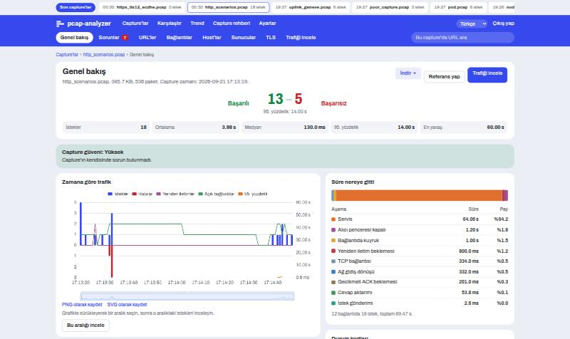

# Using pcap-analyzer

This walks through one slow-request case with the sample `http_scenarios.pcap`, which `tools/gen_samples.py` creates.

## 1. Take a capture

Open **Capture guide**, fill in the server address and port, and copy the command for where you can run it: a Linux server, a pod or a worker node. To see what a load balancer adds, capture on both sides at the same time.

## 2. Upload it

On **Captures**, choose the file. gzip files and several parts of one capture work too, up to 100 MB after unpacking. To read HTTPS, add a TLS key log under **Decrypt HTTPS**.

## 3. Read the overview

The scoreboard shows successful and failed requests. In the sample that is 13 and 5. **Where the time went** shows that service took 94% of the time, so the wait is behind the capture point and not on the network.

Check **Capture trust** first. A low value means packets are missing and the numbers may be wrong.

## 4. Open the slowest request

`GET /api/pay` took 60.00 s and ended with 504. The page explains what that means, what this capture shows and what to check next. Exactly 60 seconds points to a timeout such as NGINX's `proxy_read_timeout`.

## 5. Narrow it down

- **Issues** lists problems by weight. Open one to see its requests.
- **URLs** groups similar addresses.
- **Connections** lists TCP connections. A connection page shows its requests on a time axis.
- **Servers** marks a backend that stands out from its peers.
- **TLS** shows versions, ciphers and failed handshakes, also without a key.
- **Inspect traffic** filters by address, port, URL and size.

## 6. Compare and follow

- **Compare** shows two captures side by side, before and after a change, or both sides of a load balancer. A `traceparent` or `X-Request-ID` header gives exact matches.
- **Set as baseline** on a healthy capture makes later captures list what changed.
- **Trend** follows one URL across captures.
- **Preferences** holds the slow request limit and URL targets.

## 7. Share the result

**Download** gives the HTML report, CSV, Excel, JSON and HAR. Secrets in headers and URLs are masked in all of them. Add a case number and notes on the overview, and they go into the report.

## What each cause means

| Cause | Meaning |
|---|---|
| Slow service | The server took long before its first byte. |
| Network delay | Round trip time took the largest share. |
| Packet loss | Retransmissions cost the time. |
| Slow client | The receiver closed its TCP window. |
| Slow transfer | The body took long to arrive. |
| Slow upload | The request took long to send. |
| Queueing | The request waited for an earlier response on the same connection. |
| Delayed ACK | A sender waited for a late ACK. |
| Slow connect | The TCP handshake took long. |
| Slow TLS | The TLS handshake took long. |
| Gateway error | A proxy returned 502, 503 or 504. |
| No response | No answer arrived before the capture ended. |
| Connection reset | The connection ended with RST before an answer. |
| Incomplete response | Fewer bytes arrived than Content-Length said. |
| WebSocket connection | The connection switched to WebSocket. Only the upgrade is measured. |
